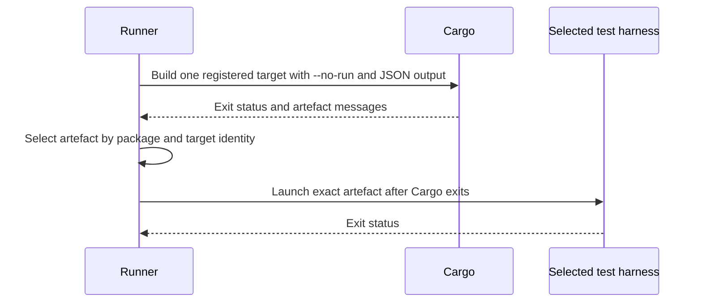

# Supervised Cargo test runner design

- **Status:** Current implementation.
- **Scope:** Repository test execution through `make test` and its CI callers.
- **Primary audience:** Podbot contributors and maintainers.
- **Precedence:** Runner modules, `Makefile`, and workflow files define the
  executable contract. The [users' guide](users-guide.md) documents the
  operator interface; the [developer's guide](developers-guide.md) documents
  maintenance and recovery. The
  [issue 188 investigation](cargo-package-cache-investigation.md) records
  observations about the triggering Cargo lock condition.

## 1. Problem and goal

The compile-contract test harness can launch nested Cargo while an outer Cargo
test process is still alive. The original incident showed a nested process
waiting on the shared package-cache lock while its parent waited for the
harness. The exact Cargo lock cause remains unproven; see the
[investigation](cargo-package-cache-investigation.md). The runner separates
registered nested-Cargo builds from the lifetime of the Cargo process that
selected them, and provides bounded supervision when a child stalls.

The goal is to preserve the repository's Cargo test selection and failure
semantics while making nested test builds, process ownership, deadlines, and
diagnostics explicit. This design does not claim a Cargo toolchain fix or
establish the cause of the original lock wait.

## 2. Constraints and non-goals

- Use the shared default Cargo cache and allow Cargo's package-cache lock to
  serialize concurrent work. Do not create a separate `CARGO_HOME` or delete
  Cargo lock files.
- Start a selected nested test harness only after its Cargo `--no-run` build
  has exited and the runner has selected the exact current-build artefact.
- Preserve Cargo options, package and target selection, test filters, harness
  arguments, and the selected fail-fast policy.
- Bound a test run with one deadline and clean up only processes owned by the
  runner. Do not terminate unrelated Cargo work.
- Keep diagnostics bounded and redact configured secret values. Sccache log
  excerpts must not upload or expose raw logs.
- Keep the coverage action outside this runner; its target selection is a
  separate workflow contract.

Diagnosing or changing Cargo's internal package-cache locking, replacing the
shared Cargo cache, and moving coverage builds into this runner are non-goals.

## 3. Architecture and phase flow

`make test` passes Cargo flags and a timeout to `scripts/test_runner.py`. The
runner loads Cargo metadata, parses supported options, constructs a test plan,
and runs its phases in order. Ordinary package tests run first, documentation
tests follow, and registered nested-Cargo targets run last. Cargo's selected
fail-fast behaviour controls whether later work is skipped. Empty phases are
reported as skipped. The `--no-run` option compiles selected ordinary tests
without starting their harnesses.

The process boundary for a nested target is:

Each target is built separately. Cargo's JSON `compiler-artifact` messages
provide paths for selection; package identity and target name prevent a stale
or unrelated executable from being run. The runner reconstructs the runtime
environment from the selected package and build messages before starting the
harness. Test filters and harness arguments are forwarded to that executable.

Doctests remain an ordinary Cargo phase because Cargo owns their harness
generation and execution. The runner does not translate them into registered
test executables.

## 4. Process ownership and terminal outcomes

The supervisor records the pre-existing child-process snapshot before launch
and tracks the child process tree it starts. On POSIX it uses process groups
and child snapshots; on Windows it uses Job Objects with the existing fallback
cleanup path. Process-tree readers observe current state without refreshing it
implicitly. Cleanup applies only to the root and descendants owned by this
runner.

One monotonic deadline covers the runner's phases. The default is 1800 seconds.
An explicit `TEST_TIMEOUT` value takes precedence over the
`PODBOT_TEST_TIMEOUT` environment fallback; when neither is set, the default
applies. Timeout returns status 124, and an interrupt returns 128 plus its
signal number. The supervisor retains the first terminal reason so later
cleanup outcomes do not replace the reason that stopped the run.

The standalone `--supervise` mode applies the same deadline and ownership
boundary to one supplied command. It does not split that command into Cargo
phases.

## 5. Diagnostics and sccache boundary

Periodic and terminal reports include the command, working directory, elapsed
time, process ancestry, toolchain details, and recognized Cargo cache or
target-lock owners and waiters. Reports are bounded and redact configured
secrets. They describe observed process and lock state; they do not prove a
Cargo-internal cause. Recovery guidance is in the developer's guide and the
issue 188 investigation.

CI configures temporary sccache error logs before server startup. An
always-executed reporting step emits bounded, sanitized excerpts and does not
change the test result or upload the raw log. This is diagnostic output for the
shared cache boundary, not a replacement for the runner's process report.

## 6. Coverage boundary

The pull-request coverage workflow invokes the pinned shared
`generate-coverage` action directly. It does not invoke `make test` or this
runner, so its Cargo lifecycle and target selection are independent. At the
current workflow configuration, all-target and doctest selection are left at
the action defaults; the registered compile-contract harness is therefore not
part of that coverage run. The developer's guide records the active action pin
and inputs. Reassess this boundary when the action version or workflow inputs
change.

## 7. Validation and implementation map

The Make dry-run contract tests verify runner invocation, timeout resolution,
and option forwarding. Workflow-contract tests keep CI test lanes routed
through Make and reject direct `cargo test` workflow steps. Python tests cover
planning, target and artefact selection, phase ordering, diagnostics,
terminal-state precedence, and process cleanup. The Rust suite retains the
compile-contract tests that exercise the nested-Cargo boundary.

Implementation is grouped by responsibility under `scripts/test_runner*.py`.
The process supervisor and its platform helpers own subprocess lifecycle; the
planning and selection modules are value-oriented; the workflow contract tests
enforce the Make and CI entry points. Update this document when those
boundaries or their externally observable contracts change.
